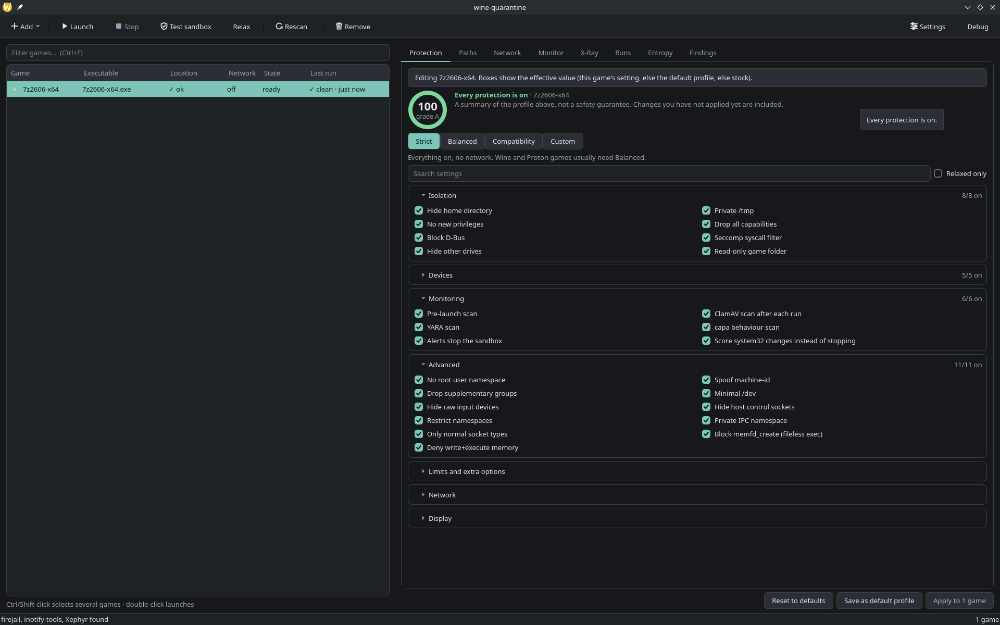
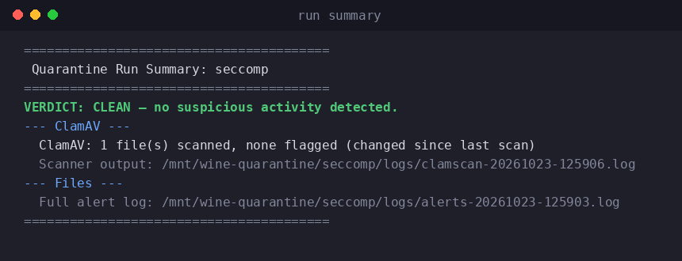
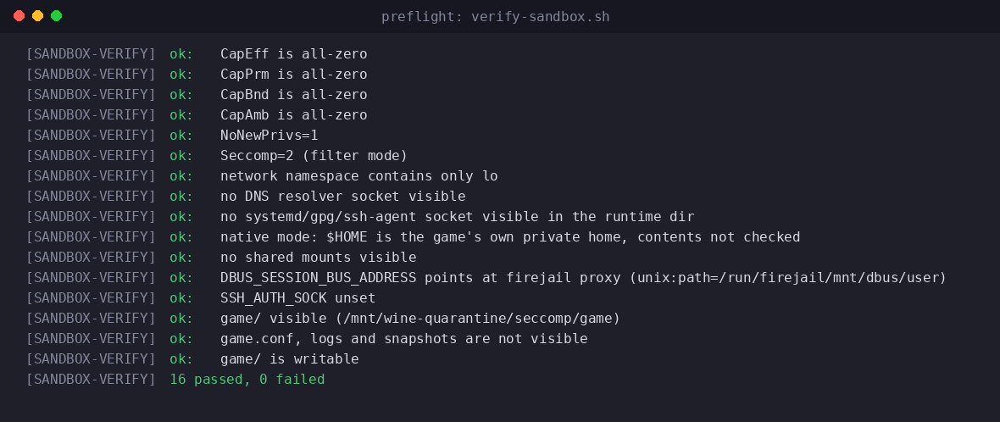

<div align="center">

# 🍷 wine-quarantine

**Run software you don't trust, without trusting it.**

A Linux sandbox for Windows (Wine/Proton) and native programs, with a built-in analyst that scans before launch, watches while it runs, and hands you a verdict when it's over.

[Quick start](#quick-start) · [How a run works](#how-a-run-works) · [The app](#the-app) · [FAQ](#faq) · [Technical guide](docs/TECHNICAL.md)

<figure align="center">
  
  <figcaption><i>The wq-ui main window</i></figcaption>
</figure>

---

## Why this exists

Cracked games, mod tools, "free" utilities, the `.exe` a stranger sent you. Normally you either trust it or you don't run it.

wine-quarantine gives you a third option: run it in a box that can't see your files, can't phone home, and can't change your system, while something keeps score of everything it tries to do.

A jail alone tells you nothing about what happened inside it. So every program goes through the same routine: **check it, lock it in, watch it, compare what changed, report.**

## What you get

| | |
|---|---|
| 🔒 **A locked-down sandbox** | Built on [firejail](https://github.com/netblue30/firejail). Out of the box there is no network, a private home folder and `/tmp`, no privilege escalation, all capabilities dropped, a syscall filter, no D-Bus and hidden devices. Every Windows game gets its own Wine prefix. |
| ✅ **A sandbox that proves itself** | Before the game starts, a verifier runs *inside* the jail and refuses to continue if anything leaks. |
| 🔍 **Scan before launch** | ClamAV, YARA (bundled rules plus the live YARAhub feed), capa behaviour rules, and static checks for packed code, injection imports, disguised programs and nasty shell lines. A high-risk result refuses the launch. |
| 👁️ **A live monitor with a kill switch** | Watches the process tree and the files the game touches. The first ALERT stops the sandbox. |
| 🧾 **A diff and a verdict afterwards** | What changed in the registry (Windows) or in startup files (Linux), a rescan of everything the run touched, then a plain verdict: `CLEAN`, `OK, minor notes` or `REVIEW NEEDED`. |
| 🖥️ **A proper desktop app** | Game list with a shield score, one-click presets, network allow-list, treemap of what a run changed, entropy plots, run history and a findings table. 15 themes. |
| 🐧 **Native Linux programs too** | Scripts, AppImages and ELF binaries use the same profile, scans and monitor. |

## See it work

Every launch ends with a summary like this one:

<p align="center"></p>

And before the game gets to run a single instruction, the sandbox checks itself from the inside:

<p align="center"></p>

If one of those lines says `LEAK`, the game does not start.

---

## Quick start

**You need:** Linux, [firejail](https://github.com/netblue30/firejail), [umu-launcher](https://github.com/Open-Wine-Components/umu-launcher), `inotify-tools`, Python 3 with PySide6, `curl` and `unzip`. ClamAV, YARA and capa are optional but strongly recommended. `install.sh` checks all of it and offers to install what is missing on Arch, Debian/Ubuntu and Fedora. You do not need Steam.

```bash
# 1. Put it OUTSIDE your home folder. firejail hides $HOME from the sandbox,
#    so anything it needs has to live somewhere else.
sudo mkdir /mnt/wine-quarantine && sudo chown $USER /mnt/wine-quarantine
git clone <repo-url> /mnt/wine-quarantine
cd /mnt/wine-quarantine

# 2. One-time setup. Safe to re-run.
./install.sh

# 3. Open the app
./wq
```

`install.sh` walks you through the rest and asks before each step: it checks packages, offers to fetch the ClamAV database if there is none, offers to download GE-Proton (SHA-512 verified, about 500 MB), downloads the umu runtime (about 200 MB, once), wires the app in, and can add a menu entry with the logo. To add or refresh it later (for example to replace the generic icon on Wayland), run `wq-ui/install-menu.sh`; `--uninstall` removes it.

**Add and run your first program**

1. In the app choose **Add > New game…** and pick a folder, `.zip`, `.iso`, `.7z`, `.rar` or a single `.exe`. The type (Windows or native Linux) is detected for you without running anything.
2. Pick the start file if it asks.
3. Press **Launch** (or double-click the game).

Prefer a terminal?

```bash
./new-quarantine.sh "My Game" ~/Downloads/mygame.zip   # Windows
wq-ui/new-native.sh "My Tool" ~/Downloads/tool.AppImage # native Linux
"./My Game/launch-quarantine.sh"                        # run it
```

> Archives and `.iso` images are **unpacked, never mounted or run**. An installer inside one is just a file in the game folder until you choose to run it.

The very first launch of a Windows game builds its Wine prefix. That step is not monitored (Wine writes hundreds of files into `system32`), so give it a moment.

---

## How a run works

```text
 ┌──────────┐   ┌──────────┐   ┌──────────┐   ┌──────────┐   ┌──────────┐
 │ 1. SCAN  │ → │ 2. LOCK  │ → │ 3. WATCH │ → │ 4. DIFF  │ → │ 5. SAY   │
 │          │   │          │   │          │   │          │   │          │
 │ ClamAV   │   │ firejail │   │ monitor  │   │ registry │   │ verdict  │
 │ YARA     │   │ + self-  │   │ + kill   │   │ / files  │   │ + logs   │
 │ capa     │   │ check    │   │ switch   │   │ + rescan │   │          │
 └──────────┘   └──────────┘   └──────────┘   └──────────┘   └──────────┘
```

1. **Scan.** Before anything runs, the game's files are checked. A ClamAV detection, a signature database older than 14 days, a high static risk score or a high-risk YARA rule **refuses the launch**.
2. **Lock.** The exact sandbox settings are test-run first, then the game starts inside the jail and the verifier checks capabilities, seccomp, network, sockets and mounts from the inside. Any failure ends the launch.
3. **Watch.** `monitor.sh` follows every process and file the game creates. Shells, download tools, script hosts, persistence spots and writes to `system32` are flagged. An **ALERT** stops the sandbox. A **WARN** is logged for you to read.
4. **Compare.** After the game exits, the registry (Windows) or the startup files, autostart entries, `~/.local/bin` and `~/.ssh` (Linux) are compared with the snapshot taken before. Whatever the run created or changed is scanned again.
5. **Say.** You get one verdict, and the full logs sit in the game's `logs/` folder.

The detailed version, with every exit code and setting, is in the [technical guide](docs/TECHNICAL.md#the-launch-pipeline).

---

## The app

Select a game, then use the tabs on the right.

| Tab | What it's for |
|---|---|
| **Protection** | The sandbox switches, in groups, with presets. A **shield ring** scores the profile from 0 to 100 as you tick boxes, before you press Apply. |
| **Paths** | Which extra folders the game may see (read-only or read-write) and optional launch scripts. |
| **Network** | Off, filtered allow-list, learn mode or open. Shows live connection attempts and a bar chart of the destinations the game has tried to reach. |
| **Monitor** | Live alerts and the run summary. |
| **X-Ray** | A treemap of what the run did to the game's folders. 🟩 already there, 🟧 changed, 🟥 **new**. Programs and probably-packed files get a heavy frame. |
| **Runs** | History of every run as a strip of bars, the sandbox's own pre-launch checks, and a timeline of what happened when. |
| **Entropy** | Plots how random each part of a file looks. A long near-random stretch inside an `.exe` is a classic sign of encrypted or packed code. |
| **Findings** | One table of everything YARA, capa, ClamAV and the heuristics found, with **Scan now** to run the pre-launch scan without starting the game. |

**Handy buttons**

* **Test sandbox** (`Ctrl+T`) runs a probe *inside* the game's real sandbox profile and lists what gets through: `ok`, `LEAK` or `info`.
* **Relax…** (`Ctrl+R`) is for a game that exits at once because one restriction is in its way, which is common under Proton. It turns restrictions off one at a time, most likely culprit first, until the game stays up. It never touches the scans, the monitor or the network, and **Undo all** puts everything back.
* **Debug** checks your setup and builds a redacted bug report you can paste into an issue.

**Shortcuts:** `Ctrl+N` new game · `Ctrl+Enter` launch · `Ctrl+.` stop · `Ctrl+F` filter · `Ctrl+1`…`6` switch tabs · `Ctrl+S` apply · `Ctrl+,` settings · `F5` rescan.

The full tab-by-tab reference is in [wq-ui/README.md](wq-ui/README.md).

### Presets

Three one-click starting points on the Protection tab. Nothing is saved until you press **Apply**.

| Preset | What it means | Good for |
|---|---|---|
| **Strict** | Everything on, no network. | Native programs, anything you're studying. |
| **Balanced** | Strict, minus read-only game folder, audio blocking, namespace restriction, memfd blocking and write+execute denial. | Most Windows games. |
| **Compatibility** | Balanced, plus gamepads and a filtered network connection. | Games that need a controller or online features. |

The scans, the pre-launch check and the monitor's kill switch are on in every preset.

---

## FAQ

**A game closes straight away.**
A restriction is probably in its way. Select it and press **Relax…** (`Ctrl+R`).

**Can a game go online?**
Not by default. On the **Network** tab you can allow specific `tcp`/`udp` destinations, or use *learn mode* to record what a game tries to reach and turn that into allow-list entries. Only learn from games you trust: a game that misbehaves while you record would get its destinations allowed too. For the live connection view to work, `install.sh` offers to set `net.netfilter.nf_log_all_netns=1`.

**Where do saves and files go?**
Everything stays in the game's own folder, `/mnt/wine-quarantine/<Game>/`: Windows games keep theirs in `prefix/`, native games in `home/`.

**How do I remove a game?**
Select it and press **Remove**. It moves to your Trash.

**How do I update?**
`git pull`, then `./install.sh`. For games made by an older version, `./update-launchers.sh --apply` brings their launchers up to date.

**Why not just use a virtual machine?**
A VM isolates more strongly. This is lighter, starts instantly, gives games your real GPU, and comes with the scanning and monitoring built in. See the next section for when to use both.

**Something looks wrong. Where do I look?**
`logs/` inside the game's folder has every launch log and alert log. The **Debug** button gathers the useful parts into a redacted report. The [troubleshooting table](docs/TECHNICAL.md#troubleshooting) lists the common failures.

---

## What it can't do

wine-quarantine lowers your risk a lot. It does not remove it, and you should know where the edges are.

* **It is a process sandbox, not a VM.** The game shares your kernel. A kernel bug, a firejail bug or a setting you loosened can let something out. For samples you *know* are hostile, run wine-quarantine inside a throwaway VM as well and keep the network off.
* **Detection is evidence, not proof.** Rules and heuristics have false positives (honest installers and patchers get flagged) and false negatives (new malware has no signature). The monitor polls, so a process that lives for under a couple of seconds can slip between two looks.
* **The shield score is a summary of your settings,** not a measurement. 100 means every switch is on, not that the game is safe.
* **Launch scripts run outside the sandbox,** on your machine, with your permissions. Only attach ones you wrote.
* **Games that need the real network or a gamepad** need those protections relaxed, and each one is a trade-off.

The technical guide spells out the [threat model](docs/TECHNICAL.md#threat-model-and-limits).

---

## Documentation

| | |
|---|---|
| 📘 [**Technical guide**](docs/TECHNICAL.md) | Architecture, the launch pipeline, every setting, detection internals, tests, troubleshooting, extending. |
| 🖥️ [**App reference**](wq-ui/README.md) | Every tab, dialog, theme and shortcut in the Qt front end. |
| 📦 [**Bundled rules**](third_party/README.md) | Where the YARA and capa rules come from and under which licenses. |

## Credits and licenses

wine-quarantine stands on the shoulders of [firejail](https://github.com/netblue30/firejail), [umu-launcher](https://github.com/Open-Wine-Components/umu-launcher), [GE-Proton](https://github.com/GloriousEggroll/proton-ge-custom), [ClamAV](https://www.clamav.net/), [YARA](https://virustotal.github.io/yara/), Mandiant's [capa](https://github.com/mandiant/capa), and these rule sets:

| Rules | License |
|---|---|
| [signature-base](https://github.com/Neo23x0/signature-base) (Neo23x0) | Detection Rule License 1.1 |
| [Yara-Rules](https://github.com/Yara-Rules/rules) | GPL-2.0 |
| [capa-rules](https://github.com/mandiant/capa-rules) | Apache-2.0 |
| [YARAhub](https://yaraify.abuse.ch/yarahub/) (abuse.ch), downloaded on demand | per rule |


wine-quarantine` is licensed under the **GNU General Public License v2.0** — see [LICENSE](LICENSE) for details. Bundled third-party rule sets under `third_party/` keep their original licenses (see [third_party/README.md](third_party/README.md)).

## License

`wine-quarantine` is licensed under the **GNU General Public License v2.0** — see [LICENSE](LICENSE) for details.
