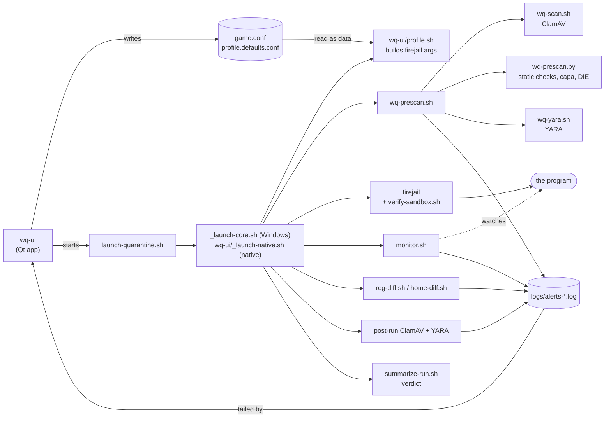
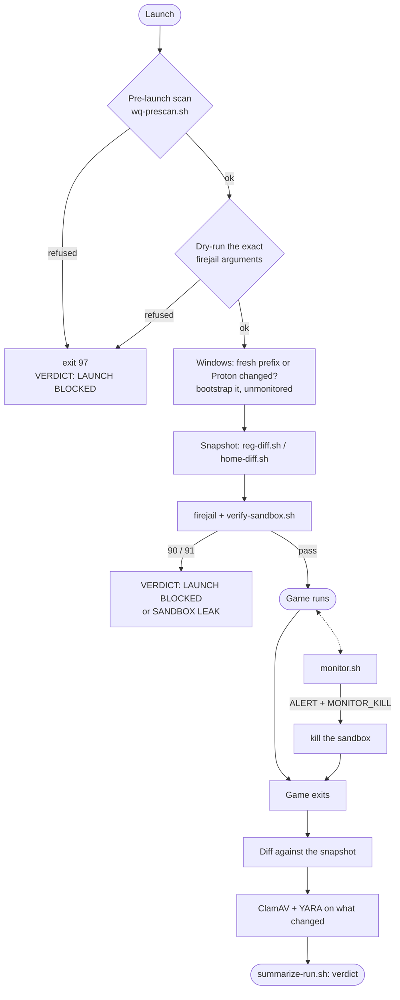

# wine-quarantine: technical guide

For people who want to know exactly what happens, change how it behaves, or work on the code. If you only want to run things safely, the [main README](../README.md) is enough.

**Contents**

1. [Design principles](#design-principles)
2. [Architecture](#architecture)
3. [Repository layout](#repository-layout)
4. [A game's folder and `game.conf`](#a-games-folder-and-gameconf)
5. [The launch pipeline](#the-launch-pipeline)
6. [The sandbox](#the-sandbox)
7. [The verifier](#the-verifier)
8. [Pre-launch scanning](#pre-launch-scanning)
9. [The runtime monitor](#the-runtime-monitor)
10. [After the run](#after-the-run)
11. [The Qt app (`wq-ui`)](#the-qt-app-wq-ui)
12. [Configuration reference](#configuration-reference)
13. [Rule sets and licensing](#rule-sets-and-licensing)
14. [Testing](#testing)
15. [Troubleshooting](#troubleshooting)
16. [Extending](#extending)
17. [Threat model and limits](#threat-model-and-limits)

---

## Design principles

These explain most of the odd-looking decisions in the code.

* **Settings are data, never code.** `game.conf` and `profile.defaults.conf` are parsed line by line (`_wq_kv`, `read_game_conf`). They are never `source`d or `eval`'d, so a file a game could somehow influence cannot run anything.
* **Fail closed.** If a setting can't be honoured, the launch is cancelled rather than quietly weakened. A memory or task limit that can't be applied cancels the launch. A download without a published checksum is refused. A YARA scan that is switched on but can't run refuses the launch. An unknown extra firejail option cancels the launch instead of being skipped.
* **Verify, don't assume.** The sandbox arguments are dry-run before use, and the verifier checks the result from inside the jail.
* **Tools that parse hostile files are jailed too.** ClamAV, YARA, capa and the archive extractors open files an attacker chose, so they run in a helper jail (see [below](#the-sandbox)).
* **Findings are signals, not verdicts.** Each static check carries points, a kind counts once however many files hit it, and the output says so.
* **Logs are cleaned before display.** Game output and file names are stripped of terminal escape sequences, bidi overrides and invisible characters (`lib-clean.sh`, `wq-colorize`), so a game can't retitle your terminal, write to your clipboard (OSC 52) or fake a verdict.
* **Logic stays testable.** The app's logic lives in Qt-free modules with their own tests. The prescan is Python standard library only.

---

## Architecture



The UI is a front end only. Every protection is enforced by the shell scripts, so the whole thing works from a terminal (`./new-quarantine.sh`, then the game's `launch-quarantine.sh`). The UI and the scripts talk through three things: `game.conf` / `profile.defaults.conf` (settings), the launcher scripts, and the log files.

`wq-ui/integrate.py` connects the two. It patches three files, each located by anchor lines rather than line numbers, and refuses to touch anything if an anchor is missing or ambiguous: it appends a block to `config.sh` that sources `wq-ui/profile.sh`, makes `_launch-core.sh` call `apply_game_profile` and add the extra whitelist arguments, and teaches `verify-sandbox.sh` which protections a profile turned off on purpose, then re-pins its hash. Originals are kept as `<file>.wq-orig`; use `--dry-run` to preview and `--revert` to undo.

---

## Repository layout

```text
wine-quarantine/
├── wq                         starts the UI (python3 wq-ui/wq_ui.py)
├── install.sh                 one-time setup, safe to re-run
├── config.sh                  paths, scan settings, firejail baseline (override in config.local.sh)
│
├── new-quarantine.sh          create a Windows game folder
├── _launch-core.sh            the launch pipeline for Windows games
├── _umu-run-wrapper           runs inside the jail: starts the exe through umu/Proton
├── update-launchers.sh        bring old launch-quarantine.sh files up to date
│
├── verify-sandbox.sh          in-jail verifier (+ verify-sandbox.sha256 self-hash)
├── monitor.sh                 runtime monitor (Windows rules; loads lib-monitor-native.sh for native)
├── lib-monitor-native.sh      detection rules for native Linux games
├── lib-runtime.sh             recognises Proton's own DLLs/EXEs by name + SHA-256
├── lib-firejail.sh            dry-run check, helper jail
├── lib-extract.sh             archive/ISO unpacking
├── lib-clean.sh               strips control/bidi/invisible characters from text
│
├── wq-prescan.sh / .py        pre-launch decision (calls the scanners below)
├── wq_indicators.py           string/structure indicators used by the prescan
├── wq-scan.sh                 ClamAV wrapper
├── wq-yara.sh                 YARA scan
├── wq-yara-build.sh           builds the compiled ruleset
├── wq-yara-update.py          fetches the YARAhub feed
├── wq-yara-info.py            scores/tiers each matching rule
├── yara-ignore.txt            rule names to leave out of the verdict
├── yara-skip.txt              rule files to leave out of the build
├── wq-scan-probe.sh           one-minute check that YARA + capa really work here
│
├── reg-diff.sh                registry snapshot/compare (Windows)
├── home-diff.sh               startup-file snapshot/compare (native)
├── summarize-run.sh           the verdict
├── wq-colorize                colours logs on a terminal, sanitises game output
│
├── third_party/               bundled rule sets (see "Rule sets and licensing")
├── docs/                      this guide and screenshots
└── wq-ui/                     the Qt app, profile builder, native launcher, probe, tests
```

Generated or local, and git-ignored: `config.local.sh`, `profile.defaults.conf`, `_proton/`, `_umu-data/`, `_umu-cache/`, `_yara-build/`, `_yara-feeds/`, `_sandbox-test/`, `.sandbox-tests/`, and every game folder's `game/`, `home/`, `prefix/`, `logs/` and snapshots.

---

## A game's folder and `game.conf`

```text
<QROOT>/<Game>/
├── game/                 the program's files
├── prefix/               its private Wine prefix            (Windows games)
├── home/                 its private $HOME, persists        (native games)
├── logs/                 alerts-*.log, launch-*.log, monitor.out, clamscan-*.log, yara-*.log,
│                         regdiff-*.log / homediff-*.log, net-attempts.jsonl, .run-score
├── game.conf             this game's settings
├── proton.path           optional: pin this game to one Proton build (first line is the path)
├── launch-quarantine.sh  three-line wrapper around _launch-core.sh or _launch-native.sh
├── .reg-snapshot/        registry snapshot   (Windows)
└── .home-snapshot/       startup-file snapshot (native)
```

`QROOT` is the checkout. Names starting with `_`, `.` or `-` are not valid game names, so the folders listed under [Repository layout](#repository-layout) can never collide with a game.

**Precedence for every setting:** `<game>/game.conf`, then `<QROOT>/profile.defaults.conf` (saved from the UI's defaults), then the built-in default in `wq-ui/profile.sh`. `FJ_EXTRA_ARGS` and the whitelists replace as a whole: a game's own list replaces the default profile's list, and an empty `FJ_EXTRA_ARGS=` line in `game.conf` means "none".

`game.conf` basics:

```ini
EXE=Game/start.exe          # path inside game/. "@prefix/drive_c/..." for something installed into the prefix
RUNNER=native               # only for native Linux games; omit for Windows
FJ_NET=0                    # any FJ_* key, see "The sandbox"
CLAM_SCAN=1                 # per-game scan switches: CLAM_SCAN, YARA_SCAN, CAPA_SCAN, PRESCAN
MONITOR_KILL=1
```

Per-game only (never read from the defaults file): `FJ_HOOK_PRE` and `FJ_HOOK_POST`, scripts that run **on the host, outside the sandbox**. A failing pre-launch hook cancels the launch. They receive `WQ_GAME`, `WQ_GAMEDIR` and `WQ_QROOT`.

---

## The launch pipeline

Windows games (`_launch-core.sh`) and native games (`wq-ui/_launch-native.sh`) follow the same shape.



In order:

1. **Logging starts.** Everything printed is also written to `logs/launch-<time>.log` (plain text; `wq-colorize` only colours what reaches a terminal). Logs older than `LOG_RETENTION_DAYS` (30) are pruned. The logger ignores `TERM`/`INT`/`HUP` so it outlives a **Stop** and the summary can still be written.
2. **Pre-launch scan** (`wq-prescan.sh`). See [Pre-launch scanning](#pre-launch-scanning). Refusal exits with 97 and prints the verdict.
3. **Proton and prefix.** Picks a Proton build: the game's `proton.path` if present, else `PROTON_PREFERRED`, else the build the prefix was created with, else the newest build in the first search dir that has one. If the prefix is new, or a different Proton than the one that made it is in use, the prefix is bootstrapped **before monitoring starts**, in the jail but unmonitored, using a throwaway `_bootstrap.bat`. Otherwise the monitor would see hundreds of `system32` writes and the kill switch would fire on Proton itself. The ClamAV and X-Ray baselines are taken after that.
4. **Profile and dry run.** `apply_game_profile` turns settings into firejail arguments; `wq_firejail_check` runs them with `true` as the program. If firejail refuses them, the run is reported as blocked instead of as a game that ran.
5. **Snapshots and allow-list.** `reg-diff.sh snapshot` (Windows) or `home-diff.sh snapshot` (native), and a hash list of Proton's own DLL/EXE files (`lib-runtime.sh`) so the monitor can tell Proton's `system32` writes from a game's.
6. **Start.** `firejail … bash -c 'verify-sandbox.sh && exec _umu-run-wrapper <exe>'` (native games run the verifier, extra native preflight checks, then the program). The launcher scrubs secrets from the environment first, and `DBUS_SESSION_BUS_ADDRESS` and `SSH_AUTH_SOCK` are unset.
7. **Monitor.** `monitor.sh <gamedir> <firejail pid> <alertlog>` runs in the background; the app tails the log. (`WQ_MONITOR_TERMINAL=1` opens it in a terminal instead.) Native games start it immediately, since they are running within milliseconds.
8. **Wait.** On **Stop**, the whole process group is signalled: the sandbox and monitor die, but the launcher carries on to the diff, scans and verdict.
9. **Post-run.** `wineserver -k`, the registry or home diff, ClamAV, YARA, then `summarize-run.sh`.

**Exit codes**

| Code | Meaning |
|---|---|
| `0` | Normal end. A native launcher exits with the game's own exit code. |
| `1` | Setup error: no Proton, missing umu runtime, invalid game, firejail failed to start. |
| `90` | `verify-sandbox.sh`: a check failed (from the jail). |
| `91` | `verify-sandbox.sh`: its own hash is missing or doesn't match. |
| `97` | Launch refused: pre-launch scan, firejail refused the arguments, or the native preflight failed. |
| `130` | Stopped before the game started. |

**Verdict priority** (`summarize-run.sh`): `SANDBOX LEAK` (a `[LEAK]` line from inside the jail) > `LAUNCH BLOCKED` > `CLEAN` (no alerts, no warnings) > `OK, minor notes` (warnings only) > `REVIEW NEEDED` (any alert). The app reads the same logs and applies the same order for its *Last run* column.

---

## The sandbox

### Baseline

`config.sh` defines the stock jail (`QUARANTINE_FIREJAIL_ARGS`):

```text
--noprofile --net=none --private --private-tmp --nonewprivs --caps.drop=all --nodbus
--seccomp.drop=$SECCOMP_DROP
```

`SECCOMP_DROP` blocks exactly this list (`--seccomp.drop=` does **not** add firejail's default blacklist):

```text
add_key request_key keyctl init_module finit_module delete_module kexec_load kexec_file_load reboot
swapon swapoff acct quotactl open_by_handle_at perf_event_open userfaultfd io_uring_setup
io_uring_enter io_uring_register bpf syslog sysfs iopl ioperm adjtimex clock_adjtime fanotify_init kcmp
```

`mount`, `umount2`, `ptrace` and `process_vm_*` are left to the per-game profile on purpose: Proton's container needs `mount`, and some Wine programs read other processes' memory. The UI's default profile adds `ptrace,process_vm_readv,process_vm_writev` through `FJ_SECCOMP_EXTRA`.

### Profile keys

`wq-ui/profile.sh` turns settings into arguments. The header of that file is the authoritative list; the main groups are:

| Group | Keys | Notes |
|---|---|---|
| Isolation | `FJ_PRIVATE_HOME`, `FJ_PRIVATE_TMP`, `FJ_NONEWPRIVS`, `FJ_CAPS_DROP`, `FJ_NODBUS`, `FJ_SECCOMP`, `FJ_NOROOT`, `FJ_NOGROUPS`, `FJ_MACHINE_ID` | `FJ_MACHINE_ID` gives a random `/etc/machine-id`. |
| Devices | `FJ_PRIVATE_DEV`, `FJ_NOINPUT`, `FJ_NOSOUND`, `FJ_NOVIDEO`, `FJ_NOU2F`, `FJ_NOTV`, `FJ_NODVD`, `FJ_DEV_BLOCK` (repeatable) | `FJ_DEV_BLOCK` hides one `/dev` node. |
| Sockets and namespaces | `FJ_BLOCK_SOCKETS`, `FJ_RESTRICT_NS`, `FJ_IPC_NS`, `FJ_PROTOCOL` | `FJ_PROTOCOL` limits sockets to unix, inet, inet6 and netlink. `FJ_IPC_NS` gives a private SysV IPC namespace (switch it off if a game draws nothing under the private X server, since MIT-SHM crosses the namespace). `FJ_RESTRICT_NS` defaults on for native games and off for Wine/Proton. |
| Filesystem | `FJ_BLOCK_MEDIA`, `FJ_HIDE_SIBLINGS`, `FJ_GAME_RO`, `FJ_WL_RW`, `FJ_WL_RO` (repeatable) | `FJ_BLOCK_MEDIA` hides `/media`, `/run/media` and `/mnt` (a path holding the game, umu data or a whitelist entry is left visible and a note is printed). `FJ_HIDE_SIBLINGS` hides other entries next to the game folder. |
| Memory | `FJ_MEMFD`, `FJ_MDWX` | `FJ_MEMFD` blocks `memfd_create` (no fileless payloads) and needs `FJ_SECCOMP`. `FJ_MDWX` is `--memory-deny-write-execute`. Wine/Proton, DXVK and every JIT need both off, so they are for native games. |
| Network | `FJ_NET`, `FJ_NET_IFACE`, `FJ_NET_DNS`, `FJ_NET_LOG`, `FJ_NET_ALLOW` (repeatable), `FJ_NET_LEARN`, `FJ_NET_OPEN` | See below. |
| Display | `FJ_XEPHYR`, `FJ_XEPHYR_SIZE` | A private X server instead of your display. firejail 0.9.82 removed `--x11=xephyr`; the profile uses plain `--x11` on newer versions. |
| Limits | `FJ_TASKS_MAX`, `FJ_MEMORY_MAX`, `FJ_SECCOMP_EXTRA` | See below. |
| Extra options | `FJ_EXTRA_ARGS` (repeatable) | Allow-listed, see below. |
| Hooks | `FJ_HOOK_PRE`, `FJ_HOOK_POST` | Per game only. Run on the host. |

### Network

* **Off** (`FJ_NET=0`, the default): `--net=none`. Because `nss-resolve` and `nscd` answer name lookups over Unix sockets that need no interface, `FJ_BLOCK_SOCKETS` also hides `/run/systemd/resolve`, `/run/nscd`, `/run/systemd/private` and `/run/containerd`. Both launchers check at start-up that the resolver socket is really gone.
* **Filtered** (`FJ_NET=1`): `--net=<FJ_NET_IFACE>` plus a generated netfilter file (`<game>/.wq-netfilter`, with an IPv6 file that allows loopback only). `FJ_NET_ALLOW` entries look like `tcp:1.2.3.4:443` or `udp:10.0.0.0/8:*`. `FJ_NET_DNS` also allows `udp/53`.
* **Logging** (`FJ_NET_LOG`): an iptables `LOG` rule in the netfilter file writes blocked/allowed attempts to the kernel log, which the app reads. The kernel only logs from non-host namespaces if `net.netfilter.nf_log_all_netns=1`; `install.sh` offers to set it persistently (`/etc/sysctl.d/99-wq.conf`, plus `nf_log_syslog` in `/etc/modules-load.d/`). It is system-wide and also lets other containers write to the host kernel log, which is why it is opt-in.
* **Learn mode** (`FJ_NET_LEARN`) records attempts so they can be staged as allow-list entries. **Open** (`FJ_NET_OPEN`) removes filtering entirely.

### Limits and extra options

`FJ_TASKS_MAX` and `FJ_MEMORY_MAX` run the whole launch inside `systemd-run --user --scope`, so they need a systemd user session. If one is set and the scope can't be created, **the launch is cancelled**. `FJ_TASKS_MAX` is used instead of `--rlimit-nproc` because that counts every process of your user. A value below what your desktop already runs would stop the game from forking at all, so `profile.sh` refuses it.

`FJ_EXTRA_ARGS` accepts only options that tighten the sandbox: `--rlimit-nofile|fsize|cpu|as|sigpending=N`, `--timeout=hh:mm:ss`, `--nice=0..19`, `--cpu=0,1`, `--blacklist=/path`, `--noexec=/path`, `--read-only=/path`, `--rmenv=NAME`, `--machine-id`, `--nosound`, `--novideo`, `--nou2f`, `--notv`, `--nodvd`, `--noroot`. Anything else (`--net`, `--whitelist`, `--ignore`, `--noprofile`, …) cancels the launch with a message. The rule lives in `_wq_extra_arg_ok` (`profile.sh`) and `check_extra_arg` (`wq_core.py`), and `test_core.py` runs both on the same inputs so they can't drift apart.

### Environment scrubbing

A game inherits the launcher's environment. Before the sandbox starts, variables whose *name* looks like a secret are removed (`WQ_ENV_SCRUB_RE`: `TOKEN`, `SECRET`, `PASSWORD`, `API_KEY`, `PRIVATE_KEY`, `AWS_*`, `GITHUB_*`, `ANTHROPIC_*`, `OPENAI_*`, `SSH_AGENT_PID`, and more), as are session identifiers from the desktop and service manager (`WQ_ENV_SESSION_RE`: `HYPRLAND_*`, `UWSM_*`, `INVOCATION_ID`, …). Set either to `""` in `config.local.sh` to turn it off. `PULSE_COOKIE` and `XAUTHORITY` are kept on purpose, audio and X11 need them.

### Helper jail

`lib-firejail.sh: wq_helper_jail` builds the command line used for everything that parses files the game controls: ClamAV, YARA, capa/DIE (through the prescan) and the archive extractors. No network, no new privileges, no capabilities, and only the paths the tool needs. Without it a parser bug would be code execution as you, and a compromised scanner could rewrite the launcher scripts that run unsandboxed next time. `CLAM_SANDBOX=0` and `YARA_SANDBOX=0` turn it off for those two. `test_helper_jail.sh` covers it.

---

## The verifier

`verify-sandbox.sh` runs **inside** the jail, before the game is `exec`'d. It exits `0` (all passed), `90` (a check failed) or `91` (self-hash problem).

**Self-hash.** It compares its own SHA-256 with `verify-sandbox.sha256` and refuses to run if the file is missing or doesn't match. After editing the verifier, run `./verify-sandbox.sh --update-hash`. Both files are mounted read-only into the jail, so the game can't change either.

**Checks** (from the screenshot in the README, plus the ones that depend on your profile): `CapEff`, `CapPrm`, `CapBnd` and `CapAmb` all zero; `NoNewPrivs=1`; seccomp in filter mode; the network namespace contains only `lo`; no DNS resolver socket; no systemd, gpg or ssh-agent socket in the runtime dir; no shared mounts; D-Bus points at firejail's proxy; `SSH_AUTH_SOCK` unset; `game/` visible and writable (or read-only with `FJ_GAME_RO`); `game.conf`, logs and snapshots **not** visible; hidden media mounts; `/dev/input` unreadable; a writable+executable mapping fails with `FJ_MDWX`; `memfd_create` fails with `FJ_MEMFD`.

**Relaxed on purpose.** When a profile switches a protection off, the check for it is skipped, not failed. That is what the integration patch teaches the verifier (`QVERIFY_SKIP` tokens such as `input`, `memfd`, `mdwx`). The skip list is set by the launcher before the game exists, so a game has no say in it.

**Native mode** (`QVERIFY_MODE=native`) runs the generic checks and skips the Wine ones (prefix, umu data, `$HOME` contents), since a native game's `$HOME` is its own persistent folder. `NATIVE_VERIFY=0` turns the extra native verifier off; the inline preflight (resolver sockets, groups, ssh-agent) still runs, and failure exits `97`.

---

## Pre-launch scanning

`wq-prescan.sh <Game>` decides whether the launch may happen. It exits `0` (go) or `1` (refused). `PRESCAN=0` in `game.conf` skips it for one game. `PRESCAN_ALLOW=1` (or `WQ_PRESCAN_ALLOW=1`) logs everything but never refuses.

Steps, in order:

1. **ClamAV** on what changed since the last scan (`wq-scan.sh`). A detection refuses the launch.
2. **Signature age.** A database older than `PRESCAN_DB_BLOCK_DAYS` (14) refuses the launch. `CLAM_STALE_DAYS` (7) only warns.
3. **Static checks** (`wq-prescan.py` and `wq_indicators.py`): standard library only, nothing is executed. Output is `FINDING <kind> <points> <message>` lines and a `SCORE`. The launch is refused at `PRESCAN_BLOCK_SCORE` (5). **A kind counts once** however many files hit it.
4. **YARA** (`wq-yara.sh`) when `yara` is installed.

### Scoring

| Points | Kinds |
|---|---|
| 5 | `yara_ransomware` |
| 4 | `attack_chain_t1059` (a cumulative ATT&CK T1059.004 chain) |
| 3 | `double_ext`, `odd_name`, `inject`, `dropper`, `shell_net`, `script_decode_exec`, `fork_bomb`, `mal_name`, `yara_encrypted`, `capa_keylog`, `capa_cred`, `capa_destroy`, `capa_exec`, `capa_net`, `ind_c2_service`, `ind_stealer`, `ind_ransom`, `ind_lolbin`, `ind_payload_desc`, `ind_revshell`, `ind_linux_dropper` |
| 2 | `packed_entropy`, `packer_protect`, `disguised`, `scriptlike`, `shell_persist`, `big_blob`, `capa_persist`, `capa_c2`, `capa_inject`, `capa_write`, `pe_unpack_stub`, `pe_odd_entry`, `pe_thin_imports`, `ind_rat_words`, `ind_linux_persist`, `yara_vmdetect` |
| 1 | `packer_upx`, `pe_wx_section`, `pe_embedded`, `ind_persist`, `ind_anti_analysis`, `mal_name_weak` |
| 0 (informational) | `die_packed`, `dotnet_framework`, `dotnet_protected` |

The table is `POINTS` in `wq-prescan.py`; treat the source as authoritative. Notable thresholds: `big_blob` needs 1 MiB at 7.5 bits per byte; packed programs are flagged at 7.2.

What the checks look for: packed code (UPX, protectors, high entropy), injection and download imports (`WriteProcessMemory`, `CreateRemoteThread`, `URLDownloadToFile`, …), disguised programs (double extensions, scripts posing as data), shell lines such as `curl … | sh`, base64-to-shell, `/dev/tcp` reverse shells and `nc -e`, persistence lines (`crontab`, `authorized_keys`, autostart), fork bombs, decode-and-exec chains, malware-ish file names, odd PE layouts (writable+executable sections, unpack stubs, almost no imports, an embedded second PE), and strings that point at stealers, C2 services, ransomware notes, LOLBins, RAT wording and anti-analysis (`wq_indicators.py`, ASCII and UTF-16).

**External analysers (optional).** `capa` (rules from `third_party/capa-rules`) and Detect It Easy (`diec`) run through the helper jail when installed. Settings: `PRESCAN_CAPA` (`auto`/`0`), `PRESCAN_CAPA_BIN`, `PRESCAN_CAPA_RULES`, `PRESCAN_CAPA_SIGS`, `PRESCAN_CAPA_ARGS`, `PRESCAN_CAPA_MAX_MB` (30), `PRESCAN_DIE`, `PRESCAN_DIE_BIN`, `PRESCAN_EXTERNAL_TIMEOUT` (120 s), `PRESCAN_EXTERNAL_MAX` (10 files), `PRESCAN_EXTERNAL_BUDGET` (180 s). Per game: `CAPA_SCAN=0|1`. Everything is bounded by `PRESCAN_TIME_CAP` (60 s). Libraries that are huge and benign (`libcef`, `libssl`, `libvulkan`, …) are skipped for ELF checks; extend with `PRESCAN_ELF_SKIP` (a regex).

### YARA

* **Ruleset.** `wq-yara-build.sh` compiles `third_party/signature-base-yara`, `third_party/yara-rules` and anything under `_yara-feeds/` into `_yara-build/rules.yarc`, once, and again when the bundled rules or the installed yara change (`YARA_AUTOBUILD`). It picks rule files from known-good folders, skips those that import modules your yara lacks, leaves out files in `yara-skip.txt` / `yara-skip.local.txt`, compiles each file alone, and lists every file it dropped, with the reason, in `_yara-build/SKIPPED.txt`. When a rule name exists in two sets, the bundled one wins. `./wq-yara.sh --check` and `--build` do what they say.
* **Severity.** `YARA_LEVEL=AUTO` (default) sorts each match with `wq-yara-info.py`: **HIGH** (rule score ≥ `YARA_BLOCK_SCORE`, 70, or an unscored rule from a malware/webshell/exploit/maldoc folder) is an ALERT and refuses the launch; **MEDIUM** (≥ `YARA_WARN_SCORE`, 40) is a warning; **INFO** is quiet. `WARN` logs every match; `ALERT` refuses on any match. Unscored rules from the YARAhub feed default to INFO (`YARA_FEED_TIER`), because they are community-submitted and some are loose enough to hit clean files such as PuTTY or Wine's own DLLs.
* **Scan scope.** Pre-launch: changed files in `game/`. After a run: `game/` plus `prefix/` (or `home/`). Scans are incremental; a full scan happens when there is no stamp, when the ruleset is newer than the stamp, after a match (until a clean full scan), and every `YARA_FULL_EVERY_DAYS` (7). Files over `YARA_MAX_FILESIZE_MB` (200) are skipped and a scan is cut off after `YARA_TIMEOUT` (300 s). Wine's text registry files are excluded by default (`YARA_EXCLUDE_REGEX`) because PE rules hit them; `reg-diff.sh` covers the registry.
* **False positives.** Add the rule name to `yara-ignore.local.txt` (`<rule>  # why`, survives updates) to drop it from the verdict. The raw `yara-*.log` still lists every match. To drop a whole rule file from the build, use `yara-skip.local.txt`.
* **Exit codes of `wq-yara.sh`.** `0` clean or disabled, `1` matches at ALERT level, `2` usage, `3` the scan is switched on but cannot run (pre-launch only: refuses the launch). Untick *YARA scan* (`YARA_SCAN=0`) to run without it.
* **YARAhub feed.** `wq-yara-update.py` downloads the public feed at most once per `YARAHUB_MIN_HOURS` (24) before scans; `YARA_FEEDS_UPDATE=0` never touches the network. The zip is treated as untrusted: HTTPS only with a size limit, entries are never extracted by path (only `*.yar`/`*.yara` names are read as data and written under a sanitised flat name), entry count and sizes are capped, and a rule file is rejected (and listed in `REJECTED.txt`) if it uses `include`, imports anything beyond `pe`, `elf`, `math` or `hash`, isn't UTF-8, or is too large. The new set replaces the old one only if at least one file survives, and the previous set is kept as `yarahub.prev`. `ABUSECH_AUTH_KEY` is sent as `Auth-Key` if set.

`./wq-scan-probe.sh` is a one-minute self-test: it builds a throwaway game with an EICAR bait file, a tiny clean PE and a PE with 1.5 MiB of random data appended, runs the same YARA, capa and prescan paths a launch would, and checks each result (`--pe FILE.exe` also lists what capa recognises in a real program).

### ClamAV

`wq-scan.sh <Game> [--when add|run|manual] [--full]`. After a run it scans only files changed since the last scan, plus a full scan every `CLAM_FULL_EVERY_DAYS` (7) so new signatures also hit old files. It scans `game/` plus `prefix/` (or `home/`). Files Wine created during the first-run bootstrap are treated as pristine runtime and skipped unless the game touches them later (`CLAM_SCAN_WINE_RUNTIME=1` scans them anyway). Findings are appended to the alert log in the monitor's format, so they appear as `ALERT` lines in the verdict. A missing ClamAV or database never blocks a launch by itself, it is reported and skipped; a database older than the prescan limit does.

---

## The runtime monitor

`monitor.sh <gamedir> <firejail pid> <alertlog>` watches two things: the process tree (polling `/proc` every `POLL_INTERVAL`, 2 s) and the filesystem (`inotifywait`). A process is judged only once it has been seen on two consecutive polls, so a process that lives for less than about two seconds can be missed. `inotifywait`'s own failures are surfaced, so a dead watcher doesn't silently mean no file monitoring.

Event format: `[2026-11-27 04:12:09] [ALERT] message`, with levels `INFO`, `WARN` and `ALERT`. Events are buffered and flushed every `LOG_FLUSH_INTERVAL` seconds but stamped when they happen. The first `ALERT` fires the **kill switch** (guarded by an atomic `mkdir`, so only one watcher fires it). `MONITOR_KILL=0` logs alerts without stopping the sandbox.

### Windows / Wine mode

| Watches | Examples |
|---|---|
| **Processes** | `powershell`, `cmd.exe`, `cscript`/`wscript`, `certutil`, `regsvr32`, `rundll32`, `mshta`, `bitsadmin`, `schtasks`, `reg.exe`, `netsh`, `vssadmin`, `wmic`, `msiexec`, `installutil`, `msbuild`, `pwsh`, `curl`, `wget`, `ssh`, `nc`, `ngrok`, `systeminfo`, `tasklist`, `whoami`, `net`/`net1`, `nltest`, `wevtutil`, … (many are seen in 2025–26 game-lure campaigns, either as the LOLBin that runs the payload or as the "am I in a sandbox?" probe) |
| **Files** | New scripts and shortcuts (`.ps1`, `.bat`, `.vbs`, `.js`, `.hta`, `.lnk`, `.url`, `.scr`, …) and executables in odd places |
| **Persistence** | Writes to `Run`, `RunOnce`, `Image File Execution Options`, `AppInit_DLLs`, `Winlogon`, `KnownDLLs`, `BootExecute`, Startup folders and similar |
| **`system32`** | A write that isn't a known Proton file is an ALERT. "Known" means same name **and** same SHA-256 as a file in the Proton build in use (`lib-runtime.sh`), or a name in the `KNOWN_RUNTIME` allow-list. During a fresh prefix, these are `INFO`. |

`MONITOR_SYS32_SCORE=1` turns an unlisted `system32` write into a *scored* alert: it still counts as `ALERT` in the verdict but does not kill the sandbox, and it adds `PRESCAN_SYS32_POINTS` (5, the launch limit) to `logs/.run-score`. The next launch is refused until you have reviewed the log and deleted `logs/.run-score`.

### Native Linux mode

`lib-monitor-native.sh` holds the rules as pure functions that print `LEVEL<TAB>KIND<TAB>message` (so they are testable without inotify). Highlights:

* **Alert processes:** `nc`/`ncat`/`socat`/`telnet`, `ssh`/`scp`/`sftp`, `curl`/`wget`, `nmap`/`masscan`/`tcpdump`, `sudo`/`su`/`pkexec`/`doas`, `crontab`/`at`, `systemctl`/`systemd-run`, `nsenter`, `setcap`, …
* **Warn processes:** clipboard and screenshot tools (`xclip`, `xdotool`, `scrot`, `grim`), `xdg-open`, `dbus-send`, `gdbus`, …
* **Interpreters are not flagged by name** (Ren'Py and plenty of itch.io games ship their own Python). They are flagged only when handed inline code (`-c`, `-e`) that opens sockets or spawns a shell, and the script an interpreter was told to run is itself inspected once.
* **Names:** a file called `reverse_shell.py` or `keylogger.sh` is an alert; `payload`, `exploit`, `dropper`, `beacon`… alone only warn.
* **Spawner and fork-storm detection:** children per parent and new processes per 10-second window. A child too quick for a poll still leaves a trace in the parent's counters, so the monitor can say "a child ran and was reaped" even if it can't say what it was.
* **Persistence files:** shell and session startup files are compared against a baseline hash taken when the monitor started, because firejail may copy skeleton dotfiles into a private home.
* A process that `exec()`s something else is judged again as what it is now (fingerprinted by kernel name plus argv).

A first-run unpack can write thousands of files; the monitor logs the first few and counts the rest.

---

## After the run

* **`reg-diff.sh`** (Windows) flattens `system.reg`, `user.reg` and `userdef.reg` to `key<TAB>value` lines (Wine writes doubled backslashes and a `#time` line after every key header, so a plain `diff` can't tell which key a changed value belongs to) and reports changes to persistence keys (`Run*`, `Image File Execution Options`, `AppInit_DLLs`, `Winlogon`, services, `Userinit`, `BootExecute`, …). Key path segments are matched as segments, not substrings, so `Software\Foo\Runtime` doesn't count as `...\Run`.
* **`home-diff.sh`** (native) snapshots the places a Linux program persists: shell and session startup files (`.bashrc`, `.profile`, `.zshrc`, `.xprofile`, …), and the directories where any file is persistence or a PATH hijack (`.config/autostart`, `.config/systemd/user`, `.local/bin`, `.local/share/applications`, `.ssh`, …), plus the list of executables under `game/`. It exists because the live monitor can miss things: inotify queue overflow, a write racing the jail setup, a rename over an existing file. Autostart, systemd user units, `environment.d`, `.local/bin` and `.ssh` are ALERTs; the rest warn.
* **Both** take the new state as the next baseline.
* **ClamAV and YARA** rescan what the run changed (see above).
* **`summarize-run.sh`** prints the verdict (priority above), lists alerts and warnings (it counts one finding as one alert; lines that merely describe another alert, such as the kill switch or ClamAV's totals line, are listed but not counted) and points at the log files.

---

## The Qt app (`wq-ui`)

PySide6. The app writes settings and starts the scripts; it never enforces anything itself. Logic is split from widgets so it can be tested without a display.

| Qt-free logic (tested directly) | Widgets / entry points |
|---|---|
| `wq_core.py`: parsing, validation, game discovery, theme tokens, presets, `check_extra_arg` | `wq_ui.py`: main window, settings, themes |
| `wq_xray_core.py`: snapshots, baseline, diff, tree, treemap layout, program sniffing | `wq_xray.py`: treemap widget, background scan |
| `wq_posture.py`: shield score (`PENALTY`) | `wq_visuals.py`: shield ring, Runs tab, host map |
| `wq_runlog.py`: history, timeline, verifier checks, connection attempts | `wq_dialogs.py`: add-game, `/dev` picker, executable picker |
| `wq_relax.py`: the Relax ladder (`LADDER`) | `wq_relax_dialog.py` |
| `wq_entropy.py`: block entropy, flagged runs | `wq_entropy_tab.py` |
| `wq_findings.py`: parse alert logs into rows | `wq_findings_tab.py` |
| `wq_notify.py`: `notify-send` for new alerts and results | `wq_sandboxtest.py`: the Test sandbox dialog |
| `wq_probe.py`: run and diff probe results | `wq_themes.py`: built-in themes and loader |
| `wq_debug.py`: dependency checks, redacted report | `integrate.py`: one-time wiring |

Shell side: `profile.sh` (settings to firejail arguments), `new-native.sh` and `_launch-native.sh` (native games), `probe.sh` (the sandbox probe).

**Where it keeps things**

| Path | Contents |
|---|---|
| `~/.config/wq-ui/settings.json` | window, splitter, tab, selection, columns, theme |
| `~/.config/wq-ui/themes/*.css` | your themes (reloaded live) |
| `~/.cache/wq-ui/xray/` | X-Ray baselines, deliberately outside the game folder |
| `~/.cache/wq-ui/relax/` | undo records for **Relax…** |
| `<game>/logs/net-attempts.jsonl` | connection attempts recorded while the app was open (capped at 512 KB, one entry per destination per second) |
| `<QROOT>/.sandbox-tests/` | the last 5 **Test sandbox** results per game |

**Shield.** Starts at 100 and loses points for each protection that is off or weakened: your home visible (14), no syscall filter (10), your display instead of the private X server (10), unrestricted network (45), learn mode (30), a whole home folder whitelisted writable (25), each host-side launch script (6), comfort switches such as audio (1). For native games, allowing `memfd_create` (2) and write+execute memory (3) also costs. A stock game scores in the high 70s; Strict with the private X server scores 100. It reads the same effective settings the launcher uses.

**Relax.** The ladder (`wq_relax.LADDER`), cheapest and most likely culprit first: namespaces, extra seccomp syscalls, read-only game folder, audio, raw input, IPC namespace, minimal `/dev`, and so on. "Success" means the `firejail` process stayed up for the quick-launch window (20 s), not that the launcher did, because the launcher spends time before and after the sandbox exists. It searches the game's own output for hints (`Bad system call`, `Cannot open display`) to reorder the ladder. It **never** touches `PRESCAN`, ClamAV, YARA, capa, `MONITOR_KILL` or anything network-related, and never relaxes to get past a refused launch, a verifier failure, a missing Proton or a monitor alert. Old lines are saved before the first change, so **Undo all** restores `game.conf` exactly, and a crash mid-session is offered a restore next time.

**X-Ray.** Baseline = path, size and date of everything under `game/`, `prefix/`, `home/` and whitelisted paths, saved before each launch (and re-taken after Wine populates a fresh prefix). A file is *modified* when size or date differs, *new* when its path isn't in the baseline (dates alone don't work, Wine and installers keep the dates of what they copy). New and modified files get their first bytes sniffed for PE/ELF/script/launcher; programs with ≥ 7.2 bits per byte over their first 64 KB (programs of 8 KB and up only) get a dotted fill. At most 400 changed files are looked at per scan, new ones first. Symlinks are never followed. *Show sandbox access* overlays the profile (read-only, hidden, both) computed from the same rules `profile.sh` uses, as data. It does not query a running sandbox.

**Entropy.** Shannon entropy per block (default 1 KB). Random data only reaches ~7.2 in a 256-byte block about a third of the time, so use the 256 B setting to inspect a spot, not to scan. Files over 512 MB are refused; reading happens on a worker thread; nothing is written.

**Themes.** Any `.css` in `~/.config/wq-ui/themes/` with `/* theme: Name */` and `@define-color` tokens (`surface`, `surface_container`, `surface_container_high`, `on_surface`, `on_surface_variant`, `primary`, `on_primary`, `outline`, `error`, `ok`, `warn`) becomes a theme. Order: base light/dark, the theme's colours, the shared stylesheet, the theme's extras, then your CSS from Settings. `test_core.py` checks every built-in theme for readable text, button and alert contrast.

---

## Configuration reference

Put overrides in `config.local.sh` (git-ignored, sourced by `config.sh`) or export them first. Per-game keys go in `game.conf`.

### Paths and Proton

| Variable | Default | Purpose |
|---|---|---|
| `UMU_DATA` | `$QROOT/_umu-data` | Shared umu runtime data. |
| `LUTRIS_UMU` | autodetected | Path to `umu-run`. |
| `STEAM_ROOT` | autodetected | Used only to find Proton builds. |
| `PROTON_SEARCH_DIRS` | `$QROOT/_proton`, then Steam's `compatibilitytools.d` | Where to look for Proton. Proton must **not** live under `$HOME` (the sandbox can't see it). |
| `PROTON_PREFERRED` | empty | Prefer a named build. |
| `<game>/proton.path` | none | Pin one game to one build. Going back to an older Proton than the prefix's isn't supported by Proton. |
| `QUARANTINE_FIREJAIL_ARGS`, `SECCOMP_DROP`, `HOME_BLACKLIST`, `BLACKLIST_PATHS` | see [The sandbox](#the-sandbox) | `HOME_BLACKLIST` is relative to `$HOME`; `BLACKLIST_PATHS` takes absolute paths. |

### Scanning

| Variable | Default | Purpose |
|---|---|---|
| `CLAM_SCAN_ON_ADD`, `CLAM_SCAN_AFTER_RUN` | `1`, `1` | When ClamAV runs. Per game: `CLAM_SCAN=0\|1`. |
| `CLAM_FULL_EVERY_DAYS` | `7` | Full scan interval after incremental ones. |
| `CLAM_STALE_DAYS` | `7` | Warn when the database is this old. |
| `CLAM_MAX_FILESIZE` | `200M` | Larger files are skipped. |
| `CLAM_SANDBOX` | `1` | Run clamscan in the helper jail. |
| `CLAM_USE_DAEMON` | `0` | `1` = `clamdscan` (needs a running `clamd`). |
| `CLAM_DB_DIR`, `CLAM_BIN`, `CLAM_EXCLUDE_REGEX` | empty | Overrides. |
| `PRESCAN_BLOCK_SCORE` | `5` | Static score that refuses a launch. |
| `PRESCAN_DB_BLOCK_DAYS` | `14` | ClamAV database age that refuses a launch. |
| `PRESCAN_TIME_CAP` | `60` | Seconds the static checks may take. |
| `PRESCAN_SYS32_POINTS` | `5` | Points an unlisted `system32` write adds (`MONITOR_SYS32_SCORE=1`). |
| `YARA_RULES` | `$QROOT/_yara-build` | A folder from `wq-yara-build.sh`, or one rule file. |
| `YARA_LEVEL` | `AUTO` | `AUTO`, `WARN` or `ALERT`. |
| `YARA_BLOCK_SCORE`, `YARA_WARN_SCORE` | `70`, `40` | AUTO tier cut-offs. |
| `YARA_FEED_TIER` | `INFO` | Tier of unscored YARAhub rules. |
| `YARA_FEEDS_UPDATE`, `YARAHUB_MIN_HOURS` | `1`, `24` | Feed refresh. `0` = never touch the network. |
| `YARA_AUTOBUILD`, `YARA_FULL_EVERY_DAYS` | `1`, `7` | Rebuild and full-scan cadence. |
| `YARA_MAX_FILESIZE_MB`, `YARA_TIMEOUT` | `200`, `300` | Scan limits. |
| `YARA_SANDBOX` | `1` | Run yara in the helper jail. |
| `YARA_EXCLUDE_REGEX` | Wine's `*.reg` files | Paths not scanned. Set to `""` to scan them. |

### Monitor, logging and misc

| Variable | Default | Purpose |
|---|---|---|
| `MONITOR_KILL` | `1` | `0` = log alerts but keep the sandbox running. |
| `MONITOR_SYS32_SCORE` | `0` | Score unlisted `system32` writes instead of alerting. |
| `POLL_INTERVAL` | `2` | Seconds between process polls. |
| `LOG_FLUSH_INTERVAL` | `2` | Seconds between log flushes. |
| `LOG_RETENTION_DAYS` | `30` | Older launch, alert and diff logs are deleted. |
| `NATIVE_VERIFY` | `1` | Run `verify-sandbox.sh` for native games. |
| `ALERT_TERMINAL` | empty | Terminal to use with `WQ_MONITOR_TERMINAL=1`. |
| `WQ_ENV_SCRUB_RE`, `WQ_ENV_SESSION_RE` | see above | Environment scrubbing. |

### Environment switches

| Variable | Effect |
|---|---|
| `WQ_PRESCAN=0` | Skip the whole pre-launch scan (used by tests). |
| `WQ_PRESCAN_ALLOW=1` | Log everything, never refuse. |
| `WQ_RUN_EXE=<file>` | Run one other file from `game/` for this launch only (the app's *Run setup file*). |
| `WQ_XRAY_BASELINE=0` | Don't take X-Ray baselines automatically. |
| `WQ_MONITOR_TERMINAL=1`, `WQ_MONITOR_HOLD=1` | Show the monitor in a terminal; keep it open. |
| `WQ_XALIA=1`, `WQ_PROTONFIXES=1` | Re-enable Proton's gamepad-UI helper and ProtonFixes downloads (disabled in the sandbox because there is no display for one and no network for the other). |
| `WQ_ALLOW_UNVERIFIED_DOWNLOAD=1` | Let `install.sh` install a GE-Proton release that publishes no checksum. |
| `NO_COLOR`, `WQ_FORCE_COLOR=1` | Control colouring of log output. |
| `ABUSECH_AUTH_KEY` | Sent as `Auth-Key` to abuse.ch if set. |

---

## Rule sets and licensing

`third_party/` holds unmodified upstream copies, each with its own license file:

| Folder | Upstream | License |
|---|---|---|
| `signature-base-yara/` | Neo23x0/signature-base (`yara/`) | Detection Rule License 1.1 |
| `yara-rules/` | Yara-Rules/rules | GPL-2.0 |
| `capa-rules/` | mandiant/capa-rules | Apache-2.0 |

The Detection Rule License asks that copies keep the authors' attribution and a link to the source, so keep those folders and their license files intact when you redistribute. **`yara-rules/` is GPL-2.0:** anyone distributing this project *with* those files has to license the combination in a way GPL-2.0 allows. If you want a more permissive license for the project itself, delete `third_party/yara-rules/`, clone it yourself and point the build at your checkout:

```bash
git clone https://github.com/Yara-Rules/rules ~/rules
./wq-yara-build.sh _yara-build third_party/signature-base-yara ~/rules
```

Naming roots on the command line replaces the default list, which is the bundled sets plus `_yara-feeds/` (the YARAhub download), so add `_yara-feeds` to the command if you want the feed too. You can point it at your own folder of `.yar` files the same way. `./wq-yara-build.sh --check _yara-build` validates without writing anything.

---

## Testing

Tests live in `wq-ui/` and are plain scripts that print a final status line and exit non-zero on failure.

```bash
# Qt-free logic (no display needed)
for t in test_core test_xray test_posture test_runlog test_relax test_findings \
         test_entropy test_entropy_discovery test_indicators \
         test_notify test_probe test_setup; do python3 wq-ui/$t.py; done

# Qt widgets, run offscreen (needs PySide6)
python3 wq-ui/test_sandboxtest_qt.py
python3 wq-ui/test_protection_ui.py
python3 wq-ui/test_entropy_tab_logic.py

# Shell: profile building, launchers, scanners, monitor rules, verifier
bash wq-ui/test_profile.sh
bash wq-ui/test_launchers.sh
bash wq-ui/test_verify.sh
# ... see wq-ui/test_*.sh for the rest
```

| Area | Tests |
|---|---|
| Profile and settings | `test_core.py`, `test_profile.sh`, `test_protection_ui.py`, `test_relax.py`, `test_posture.py` |
| Launching | `test_launchers.sh`, `test_new_native.sh`, `test_umu_wrapper.sh`, `test_firejail_check.sh`, `test_helper_jail.sh`, `test_runtime.sh`, `test_lib.sh` |
| Verification | `test_verify.sh`, `test_sandboxtest_qt.py`, `test_probe.py` |
| Scanning | `test_prescan.sh`, `test_indicators.py`, `test_yara_build.sh`, `test_yara_scan.sh`, `test_yara_update.sh`, `test_external_analyzers.sh`, `test_findings.py` |
| Monitoring and diffs | `test_native_monitor_scan.sh`, `test_regdiff.sh`, `test_runlog.py`, `test_notify.py` |
| Analysis views | `test_xray.py`, `test_entropy.py`, `test_entropy_discovery.py`, `test_entropy_tab_logic.py` |
| Setup | `test_setup.py` |

`test_profile.sh` builds and checks arguments without needing firejail, but that means it can't prove a real sandbox works. For that, use **Test sandbox** (`Ctrl+T`) or run `wq-ui/probe.sh` as a native game (`--quiet`, `--net-target HOST:PORT`) and read what it reports (`ok`, `LEAK`, `info`). Run it twice with different toggles and diff the outputs. The app's **Changes since last run** view does that for you, and a setting that changed with no check flipping means the probe has no check for it yet.

---

## Troubleshooting

The app's **Debug** button runs the dependency checks and builds a redacted report. `logs/launch-*.log` and `logs/alerts-*.log` in the game's folder hold the detail.

| Symptom | Cause and fix |
|---|---|
| `install.sh`: "… is inside your home folder" | firejail's `--private` hides `$HOME`. Move the checkout to `/mnt/wine-quarantine` (the script offers to). |
| `toolmanifest.vdf not found`, or Proton "not found" in the jail | Proton is under `$HOME`. Copy it into `$QROOT/_proton` (the installer offers to). |
| `umu runtime is not downloaded yet` | The runtime can't be fetched from inside a no-network sandbox. Run `./install.sh` once (needs internet). |
| `umu-run not found or is a ZIP archive` | Install `umu-launcher` from your package manager or its releases page, or set `LUTRIS_UMU` in `config.local.sh`. |
| `wq-ui profile not loaded - run: python3 wq-ui/integrate.py` | The integration patch isn't applied. Run it (`install.sh` does this for you). |
| `wq: firejail refused these options` / `LAUNCH BLOCKED` | Your firejail build doesn't support an option in the profile. The message prints firejail's own error. Switch off the matching box, or update firejail. |
| Exit `90` / `SANDBOX LEAK` | A verifier check failed. The failed check is printed; it means the jail isn't doing something it should. Don't override it, fix the cause. |
| Exit `91` | `verify-sandbox.sha256` is missing or doesn't match. After editing the verifier, run `./verify-sandbox.sh --update-hash`. |
| Exit `97` with a YARA message | YARA is on but can't run (no `yara`/`yarac`, or the ruleset failed to build). Install `yara`, or untick *YARA scan* for that game. |
| Launch refused: ClamAV database too old | Run `sudo freshclam`. The limit is `PRESCAN_DB_BLOCK_DAYS` (14). |
| Launch refused after a `system32` note | `MONITOR_SYS32_SCORE` left a score in `logs/.run-score`. Review the log, then delete the file. |
| Launch cancelled mentioning a limit or scope | `FJ_TASKS_MAX` / `FJ_MEMORY_MAX` need `systemd-run --user`. Fix the user session or clear the limit. |
| Game exits immediately | A restriction is in its way. Use **Relax…**, or read the game's own output in the launch log. |
| Game draws nothing under the private X server | Try switching `FJ_IPC_NS` off (MIT-SHM crosses the namespace). |
| Network tab stays empty though connections happen | `net.netfilter.nf_log_all_netns` is not `1`. Run `sudo sysctl -w net.netfilter.nf_log_all_netns=1` (and see `install.sh` for persisting it). The filter itself works either way. |
| A clean file is flagged by a YARA rule | Add the rule name to `yara-ignore.local.txt`, or the rule file to `yara-skip.local.txt`, with a comment saying why. |
| `YARA scan was skipped` / capa missing | Both are optional. `./wq-scan-probe.sh` tells you what works on this machine. |

---

## Extending

* **A new static indicator.** Add an entry in `wq_indicators.py` (`_add(category, family, anchor, regex)`) and, for a new category, a row in `CATEGORIES` and a `POINTS` entry in `wq-prescan.py`. `test_indicators.py` shows the shape.
* **A new sandbox switch.** Add it to `BOOL_OPTS` in `wq_core.py` (with a tooltip and group), handle it in `profile.sh`, add a verifier check or a probe row if it can be tested, and a `PENALTY` in `wq_posture.py`. If it belongs in a preset, update `_STRICT`/`_BALANCED`/`_COMPAT`. Extra firejail options need both `_wq_extra_arg_ok` and `check_extra_arg` updated, and `test_core.py` will tell you if they disagree.
* **A new Relax step.** Add it to `wq_relax.LADDER`; mark it as costly if it should always ask first.
* **A new theme.** Drop a CSS file in `~/.config/wq-ui/themes/`, or add it to `wq_themes.py` (the contrast test will check it).
* **A new native-monitor rule.** Add a pure function to `lib-monitor-native.sh`, then a case to `test_native_monitor_scan.sh`.
* **Conventions.** Keep logic in Qt-free modules with a test; keep the prescan standard-library only; read configuration as data; refuse rather than skip when a safety setting can't be applied.

---

## Threat model and limits

**What it is built to stop.** An untrusted program, running as you, that tries to: read or change your files; reach the network or your local services; persist across runs (autostart, registry, shell profiles, `~/.ssh`); gain privileges through common routes (setuid, capabilities, `ptrace`, `bpf`, `io_uring`, `userfaultfd`, obscure socket families); inject into other processes; or arrive packed, encrypted or disguised.

**What it does not stop, and what to do about it.**

* **The kernel is shared.** firejail uses namespaces, seccomp and capability dropping on your running kernel. A kernel vulnerability reachable through an allowed syscall defeats it. firejail is itself a privileged (setuid) program and part of what you must trust. For samples you *know* are hostile, run all of this inside a disposable VM and keep `FJ_NET` off.
* **Graphics and devices.** Games need the GPU, so the driver stack is attack surface. Hiding `/dev` nodes you don't need (`FJ_PRIVATE_DEV`, `FJ_DEV_BLOCK`) reduces it, and a private X server keeps the game off your real display.
* **Whatever you relax.** Each box you untick, each whitelisted folder and every `FJ_NET_ALLOW` entry is a hole you chose. The shield ring exists to show you the bill. Never whitelist your whole home or `/` read-write.
* **Host-side scripts.** `FJ_HOOK_PRE` / `FJ_HOOK_POST` run unsandboxed.
* **Detection gaps.** Signatures miss new samples; heuristics flag honest patchers and installers. The monitor polls (2 s) and judges a process after two sightings, and `inotify` queues can overflow, which is why the registry and home diffs exist as a second look. Strongly encrypted payloads are visible only as high entropy.
* **The verifier checks what it knows to check.** A pass means those properties hold, not that no escape exists.
* **A clean verdict is not a certificate.** It means nothing this tool looks for was seen during that run.

If you find a way out of the sandbox, a verifier check that should exist, or a profile option that weakens more than its label says, that is exactly the kind of bug report this project wants.
